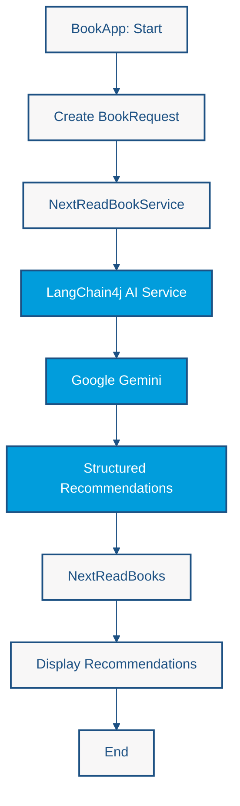

# Lab 1: Hello World

<span class="lab-meta">Duration: 20 minutes · Enterprise Java · LangChain4j · CDI</span>

## Introduction

This lab establishes the foundation for the workshop: a minimal Enterprise Java application that sends a prompt to a Large Language Model (LLM) and returns the response, with the model client managed by CDI.

**Objective:** Connect Enterprise Java to a Large Language Model using LangChain4j and CDI.

## Learning objectives

By the end of this lab you will be able to:

- Explain the role of the model integration boundary in an enterprise application
- Describe how a chat model is configured and exposed as a CDI bean
- Keep credentials outside source code using environment variables
- Send a first prompt to Google Gemini through LangChain4j

## Architectural concept

The **model integration boundary** is the single place where your application talks to an external AI provider. Isolating it behind an abstraction lets the rest of the application depend on a stable interface, while provider choice, credentials, timeouts, and model parameters stay configurable. CDI provides the natural mechanism: a producer creates and configures the chat model, and application services receive it through injection.

```text
Client → Application service → ChatModel (CDI bean) → Gemini API
```

## Architecture: A Deterministic DAG Workflow

**DAG** stands for *Directed Acyclic Graph*:

- **Directed:** execution follows a defined direction, from one step to the next.
- **Acyclic:** the workflow contains no control-flow cycles; it never loops back to an earlier step.
- **Graph:** components and operations are connected through dependencies.

The Lab 1 book recommendation application is a simple DAG. The developer defines the execution path:

1. Start the Java application (`BookApp`).
2. Create the `BookRequest`.
3. Invoke the CDI-managed AI service (`NextReadBookService`).
4. Send the request to Gemini through LangChain4j.
5. Receive structured recommendations.
6. Display the results.
7. Finish execution.



Every arrow points forward and no arrow returns to an earlier node, so the graph is acyclic.

The model generates content, but it does not decide which application step runs next. Orchestration is **deterministic** and owned by the Java code; the content of the recommendations is **probabilistic** and comes from the model.

### Why start with a DAG?

A deterministic workflow provides predictable execution, explicit responsibilities, straightforward debugging, and clear integration boundaries. The AI model is responsible for generating recommendations, while the Java application remains responsible for orchestration.

The recommendations can vary between executions, even though the Java workflow follows the same predefined sequence every time. This is an important starting point before exploring more autonomous architecture patterns.

## Prerequisites

- Completed [Getting Started](../getting-started.md)
- A valid `GEMINI_API_KEY` available as an environment variable
- JDK, Maven, and an IDE configured as described in the setup guide

## Step-by-step implementation

1. **Add dependencies** — declare the LangChain4j and Gemini integration dependencies after verifying versions.
2. **Configure the model** — read the API key from the environment and select a model.
3. **Produce the model with CDI** — expose the chat model as an injectable bean.
4. **Create a service** — inject the model and send a prompt.
5. **Expose or invoke the service** — trigger the call from a simple entry point.

!!! note "Implementation pending"
    The Java sources for this lab are not available yet. Detailed instructions, code listings, and commands will be added once the lab implementation is verified against the actual dependencies and framework APIs.

## Running the lab

!!! note "Implementation pending"
    Run instructions will be documented after the lab code is added to the repository.

## Expected results

A prompt sent to the application returns a natural-language response generated by the model. Exact output varies between executions and will be documented after implementation.

!!! note "Implementation pending"
    Verified sample output will be published with the implementation.

## Architectural trade-offs

- **Provider coupling:** a thin boundary reduces, but does not eliminate, dependence on a specific provider.
- **Latency and availability:** remote calls are slower and less reliable than local calls; plan timeouts and error handling.
- **Non-determinism:** identical prompts may yield different responses.

## Further reading

- [LangChain4j documentation](https://docs.langchain4j.dev/)
- [Jakarta CDI specification](https://jakarta.ee/specifications/cdi/)
- [Gemini API documentation](https://ai.google.dev/gemini-api/docs)

---

[Continue to Lab 2](lab2-memory.md)
