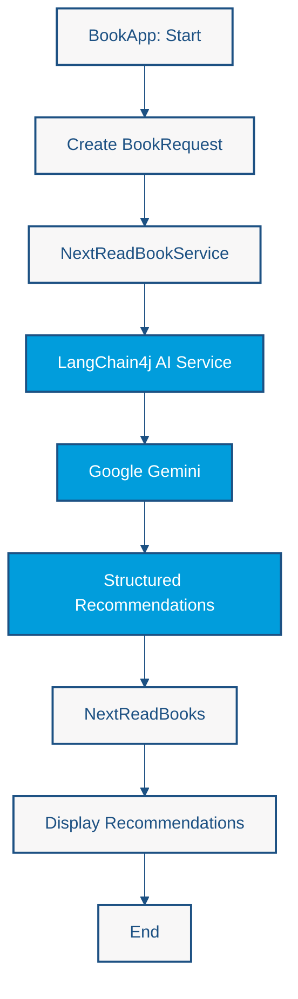

# Lab 1 — Your First AI Application: Book Recommendations

<span class="lab-meta">Duration: 20 minutes · Enterprise Java · LangChain4j · CDI</span>

*Build an AI-powered book recommendation application using Enterprise Java, LangChain4j, and CDI.*

## The Problem

Imagine you have just finished reading *Clean Code* by Robert C. Martin. You want to decide what to read next to advance your software engineering knowledge.

A static recommendation system relies on a manually curated catalog or predefined relationships between books. That works, but someone has to build and maintain the catalog.

In this exercise we use an LLM instead. Gemini generates recommendations based on **thematic similarity, conceptual progression, and complementary knowledge**.

!!! note "Generative, not verified"
    This is *generative* recommendation, not catalog retrieval. The model may suggest books from its training knowledge, and details such as titles, authors, or descriptions are not checked against any catalog. Treat them as suggestions to verify.

## Our Goal

Create an application that:

1. Receives a previously read book.
2. Requests up to three book recommendations from Gemini.
3. Receives the recommendations as **structured Java objects**.
4. Displays the title, author, description, keywords, and recommendation reason of each suggestion.

**Input:** the book *Clean Code* by Robert C. Martin.

**Acceptance criteria:**

- The application starts Weld SE and finishes without errors.
- Up to three recommendation blocks are printed.
- Every block shows title, author, keywords, description, and reason.
- The recommendations are typed Java objects, not text parsed by hand.

## Learning objectives

By the end of this lab you will be able to:

- Explain how LangChain4j integrates with CDI
- Define an AI service as an interface, without writing an implementation
- Steer model behavior with a system message
- Map model output to Java records (structured output)
- Explain why the orchestration is deterministic while the generated content is probabilistic

## Architecture: A Deterministic DAG Workflow

**DAG** stands for *Directed Acyclic Graph*:

- **Directed:** execution follows a defined direction, from one step to the next.
- **Acyclic:** the workflow contains no control-flow cycles; it never loops back to an earlier step.
- **Graph:** components and operations are connected through dependencies.

The application is a simple DAG. The developer defines the execution path:

1. Start the Java application (`BookApp`).
2. Create the `BookRequest`.
3. Invoke the CDI-managed AI service (`NextReadBookService`).
4. Send the request to Gemini through LangChain4j.
5. Receive structured recommendations.
6. Display the results.
7. Finish execution.



Every arrow points forward and no arrow returns to an earlier node, so the graph is acyclic.

The main components:

| Component | Role |
|---|---|
| `BookApp` | Java SE entry point; starts CDI and drives the workflow |
| `BookRequest` | Input: the book that was already read |
| `NextReadBookService` | Declarative AI service interface; LangChain4j generates its implementation |
| `ChatModel` (configured) | Gemini model that LangChain4j CDI registers from configuration |
| `NextReadBooks`, `Recommendation`, `Book` | Output: typed Java objects |

The model generates content, but it does not decide which application step runs next. Orchestration is **deterministic** and owned by the Java code; the content of the recommendations is **probabilistic** and comes from the model.

### Why start with a DAG?

A deterministic workflow provides predictable execution, explicit responsibilities, straightforward debugging, and clear integration boundaries. The AI model is responsible for generating recommendations, while the Java application remains responsible for orchestration.

The recommendations can vary between executions, even though the Java workflow follows the same predefined sequence every time. This is an important starting point before exploring more autonomous architecture patterns.

## Prerequisites

- Completed [Getting Started](../getting-started.md): Java 21, Maven, IntelliJ IDEA, and a `.env` file containing `GEMINI_API_KEY`
- The repository cloned, with `src/main/java/os/expert/lab1/` ready for your classes (it may contain only `package-info.java`)

### What is already configured

The Maven project already provides LangChain4j, the Gemini integration, LangChain4j CDI, Weld SE, and SmallRye Config. Two resource files also exist, so you do not create them:

- `src/main/resources/META-INF/beans.xml` enables CDI bean discovery (`annotated` mode).
- `src/main/resources/META-INF/microprofile-config.properties` configures the Gemini chat model:

```properties
dev.langchain4j.cdi.plugin.chat-model.class=dev.langchain4j.model.googleai.GoogleAiGeminiChatModel
dev.langchain4j.cdi.plugin.chat-model.config.api-key=${GEMINI_API_KEY}
dev.langchain4j.cdi.plugin.chat-model.config.model-name=gemini-3.5-flash
```

(The file may contain a few more settings, such as temperature, retries, and a timeout.) The LangChain4j CDI extension reads these properties and **registers a `ChatModel` bean automatically**. You never write a model producer, and the API key stays outside your Java code: `${GEMINI_API_KEY}` is resolved from the environment or from your local `.env` file.

If the file lists a model that your key cannot use (for example an HTTP 404 response), change `model-name` to one available to you.

## Step-by-step implementation

Create all classes in the package `os.expert.lab1`, in this order. In IntelliJ, right-click the package → **New → Java Class** (choose **Record** where indicated).

1. `BookRequest`: the input
2. `Book`: one book
3. `Recommendation`: a book plus the reason
4. `NextReadBooks`: the result container
5. `NextReadBookService`: the AI service
6. `ConsoleColors`: output formatting
7. `BookApp`: the entry point

The first four are the **data model**. Steps 1-4 do not call the model, and they define the shape of what goes in and what comes back.

### Step 1: The request

**Why?** The service needs a clearly typed input instead of a loose string. Inside `os.expert.lab1`, create a new Java record named `BookRequest` at `src/main/java/os/expert/lab1/BookRequest.java`:

```java
package os.expert.lab1;

public record BookRequest(String title,  String author) {
}
```

The record carries the title and author of the book the reader finished. LangChain4j will include it in the prompt sent to Gemini, so the model sees the input as a structured value.

### Step 2: The recommended book

**Why?** We want the model to return a book with specific fields, not free text. Create a record named `Book` at `src/main/java/os/expert/lab1/Book.java`:

```java
package os.expert.lab1;

import java.util.List;

public record Book(
        String title,
        String author,
        String description,
        List<String> keywords
) {
}
```

These fields define what the model must produce for each book. The field names matter: LangChain4j uses them to describe the expected structure to the model, so `keywords` tells Gemini to return a list of keywords.

### Step 3: The recommendation

**Why?** A book alone does not explain *why* it was suggested. Create a record named `Recommendation` at `src/main/java/os/expert/lab1/Recommendation.java`:

```java
package os.expert.lab1;

public record Recommendation(
        Book book,
        String reason
) {
}
```

It composes a `Book` with a short `reason`. Records can nest, and the structured output mapping follows the nesting.

### Step 4: The result container

**Why?** The service must return several recommendations in one object. Create a record named `NextReadBooks` at `src/main/java/os/expert/lab1/NextReadBooks.java`:

```java
package os.expert.lab1;

import java.util.List;

public record NextReadBooks(List<Recommendation> recommendations) {
}
```

This is the type your AI service returns. Wrapping the list in a record gives the response a named root object.

**Checkpoint:** run **Build → Build Project** (or `mvn compile`). It should succeed.

### Step 5: The AI service

**Why?** This is the integration boundary: the single place where your application talks to the model. Create an interface named `NextReadBookService` at `src/main/java/os/expert/lab1/NextReadBookService.java`:

```java
package os.expert.lab1;

import dev.langchain4j.cdi.spi.RegisterAIService;
import dev.langchain4j.service.SystemMessage;
import jakarta.enterprise.context.ApplicationScoped;

@RegisterAIService
@ApplicationScoped
public interface NextReadBookService {

    @SystemMessage("""
        Recommend up to 3 books that should naturally follow
        the provided book in a learning journey.

        Recommendations should prioritize:
        - conceptual progression
        - complementary knowledge
        - technical depth
        - thematic similarity

        For each recommendation provide:
        - title
        - author
        - concise description
        - relevant keywords
        - a short recommendation reason

        Keep recommendations concise, technically relevant,
        and focused on software engineering and architecture learning.
        """)
    NextReadBooks recommend(BookRequest request);
}
```

There is no implementation class, and you do not write one. LangChain4j generates it. What each part does:

- **`@RegisterAIService`** (from LangChain4j CDI) tells the CDI extension to treat this interface as an AI service. It builds an implementation at startup, wired with the `ChatModel` bean registered from `microprofile-config.properties`.
- **`@ApplicationScoped`** gives the generated bean a normal CDI scope, so you can look it up or `@Inject` it like any other bean.
- **`@SystemMessage`** supplies the standing instructions for the model: what to recommend, which criteria to favor, and which fields to return. This text strongly steers behavior, but it does not guarantee it, because the output is probabilistic.
- **`NextReadBooks recommend(BookRequest request)`** is the contract. The method parameter becomes the user input, and the **return type** tells LangChain4j what to produce.

**Structured output mapping.** Because the return type is a record rather than `String`, LangChain4j describes its structure to the model, asks for a matching response, and converts the model's answer into `NextReadBooks`, `Recommendation`, and `Book` objects. Your code works with typed values, not text you parse yourself. If the model's answer does not fit the structure, the call fails with an exception, so treat model output as external input at the application boundary.

### Step 6: Console colors

**Why?** The application prints several fields per book, and colors make each block easy to scan. This class is only formatting; it has nothing to do with AI. Create a class named `ConsoleColors` at `src/main/java/os/expert/lab1/ConsoleColors.java`:

```java
package os.expert.lab1;

public class ConsoleColors {

    public static final String RESET = "\033[0m";

    public static final String GREEN = "\033[0;32m";
    public static final String CYAN = "\033[0;36m";
    public static final String YELLOW = "\033[0;33m";
    public static final String BLUE = "\033[0;34m";
    public static final String PURPLE = "\033[0;35m";

    private ConsoleColors() {
    }
}
```

The constants are ANSI escape sequences. IntelliJ's Run console renders them as colors.

### Step 7: The entry point

**Why?** Something must start CDI and drive the workflow. Create a class named `BookApp` at `src/main/java/os/expert/lab1/BookApp.java`:

```java
package os.expert.lab1;

import jakarta.enterprise.context.control.RequestContextController;
import jakarta.enterprise.inject.se.SeContainer;
import jakarta.enterprise.inject.se.SeContainerInitializer;

public class BookApp {

    public static void main(String[] args) {

        try(SeContainer container = SeContainerInitializer.newInstance().initialize()) {

            var requestContextController = container.select(RequestContextController.class).get();
            requestContextController.activate();
            var service = container.select(NextReadBookService.class).get();
            var bookRequest = new BookRequest("Clean Code", "Robert C. Martin");
            var books = service.recommend(bookRequest);

           books.recommendations().forEach(recommendation -> {
               System.out.println(ConsoleColors.GREEN + "━━━━━━━━━━━━━━━━━━━━━━━━━━━━━━━━━━━━━━━━━━━" + ConsoleColors.RESET);

               System.out.println(ConsoleColors.PURPLE + "📚 NEXT READ RECOMMENDATION" + ConsoleColors.RESET);

               System.out.println();

               System.out.println(ConsoleColors.BLUE + "Title: " + ConsoleColors.RESET + recommendation.book().title());

               System.out.println(ConsoleColors.BLUE + "Author: " + ConsoleColors.RESET + recommendation.book().author());

               System.out.println(ConsoleColors.YELLOW + "Keywords: " + ConsoleColors.RESET + String.join(", ", recommendation.book().keywords())
               );

               System.out.println();

               System.out.println(ConsoleColors.CYAN + "Description:" + ConsoleColors.RESET);

               System.out.println(recommendation.book().description());

               System.out.println();

               System.out.println(ConsoleColors.GREEN + "Why this book?" + ConsoleColors.RESET);

               System.out.println(recommendation.reason());

               System.out.println();

               System.out.println(ConsoleColors.GREEN + "━━━━━━━━━━━━━━━━━━━━━━━━━━━━━━━━━━━━━━━━━━━" + ConsoleColors.RESET);

               System.out.println();
            });

            requestContextController.deactivate();
        }
    }
}
```

The code follows the DAG from the architecture diagram:

1. **`SeContainerInitializer.newInstance().initialize()`** starts Weld SE, discovers the beans, and lets the LangChain4j CDI extension register the model and your AI service. The try-with-resources block shuts the container down at the end.
2. **`RequestContextController`** activates the CDI request context for the duration of the call, because this Java SE application has no web container to do it. The AI service is invoked inside that active context, which keeps request-scoped CDI objects usable if the extension or your own beans need them.
3. **`container.select(NextReadBookService.class).get()`** looks up the generated AI service bean.
4. **`new BookRequest("Clean Code", "Robert C. Martin")`** creates the input.
5. **`service.recommend(bookRequest)`** sends the request to Gemini through LangChain4j and returns a `NextReadBooks`.
6. **The `forEach`** renders each recommendation using `ConsoleColors`.
7. **`deactivate()`** ends the request context and the container closes.

This code is the whole workflow, and it is written by you. The model never decides what runs next.

**Checkpoint:** `mvn compile` should succeed. A failure here means a missing import, wrong package, or a missing class from the previous steps.

## Run the application

1. Open the project in IntelliJ IDEA and confirm the project SDK is Java 21.
2. Make sure `.env` exists in the repository root with your `GEMINI_API_KEY` (see [Getting Started](../getting-started.md)). Never commit it.
3. Open `BookApp` and click the green run icon next to `main`, or choose **Run → Run 'BookApp.main()'**.
4. In the run configuration, set the **working directory** to the repository root (`$PROJECT_DIR$`), so `.env` is found.
5. Read the console output.

The first run takes longer because the Gemini request takes a few seconds. Weld itself starts in about a second.

### Troubleshooting

| Symptom | Likely cause |
|---|---|
| Startup error about an unresolved `GEMINI_API_KEY`, or the model rejects the key | `GEMINI_API_KEY` is missing, or the working directory is not the repository root so `.env` is not found |
| HTTP 400 / 403 | The API key is invalid |
| HTTP 404 for the model | The model in `microprofile-config.properties` is not available to your key; choose another |
| HTTP 429 / 503 or a timeout | Rate limit or high demand; retry later or pick another model |
| Class not found or build errors | A class is missing, or it is in the wrong package or path |

## Expected results

You should see up to three blocks, each with a title, author, keywords, description, and reason. A *verified* example is one actual run of this lab against Gemini; the content below is shortened from that run:

```text
📚 NEXT READ RECOMMENDATION

Title: Refactoring: Improving the Design of Existing Code
Author: Martin Fowler
Keywords: refactoring, code smells, software design, ...

Description:
A comprehensive catalog of code smells and step-by-step techniques ...

Why this book?
Provides the systematic, safe transformation mechanics needed ...
```

Your recommendations will be different on other runs and with other models. That is expected: the Java workflow is identical every time, but the generated content is not. What you should check is **structure** (all fields present, up to three books), not exact books or wording.

## Architectural trade-offs

- **Provider coupling:** the AI service interface isolates your code from the provider, but prompts, model names, and structured-output behavior still vary between providers.
- **Latency and availability:** remote calls are slower and less reliable than local calls; plan timeouts and error handling.
- **Non-determinism:** identical inputs can produce different recommendations.
- **Unverified content:** generated titles and descriptions can be wrong. A production system would check them against a trusted catalog.
- **Structured output is a contract, not a guarantee:** a malformed or off-schema answer raises an error you must handle.
- **Credentials:** the key stays in `.env` or the environment, never in source code.

## Try It Yourself

1. Change the `BookRequest` to a different book (for example, a book about distributed systems) and run again.
2. Edit the `@SystemMessage` to ask for a different number of books or to favor beginner-level titles. How does the output change?

## Further reading

- [LangChain4j AI Services](https://docs.langchain4j.dev/tutorials/ai-services)
- [Jakarta CDI specification](https://jakarta.ee/specifications/cdi/)
- [Gemini API documentation](https://ai.google.dev/gemini-api/docs)

---

[Continue to Lab 2](lab2-memory.md)
