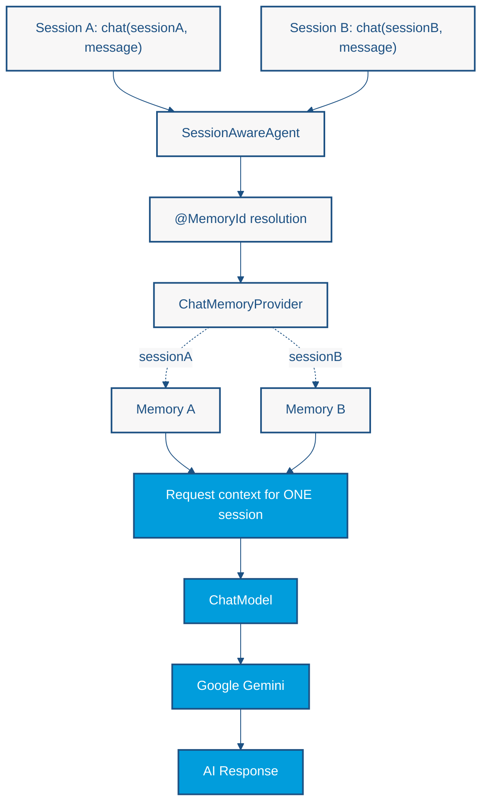

# Lab 2 — Conversational Memory and Session Isolation

<span class="lab-meta">Duration: 25 minutes · Enterprise Java · LangChain4j · CDI</span>

*Build a conversation-aware AI assistant using LangChain4j, CDI, and session-specific chat memory.*

## The Problem: AI Without Memory

A typical LLM invocation does **not** remember requests made through separate API calls. Imagine an assistant receiving two messages:

1. "My favorite programming language is Java."
2. "What is my favorite programming language?"

If the second request is sent on its own, without the earlier context, the model has no way to know the answer.

Conversation memory is therefore **application-managed context**, not an intrinsic persistent memory belonging to the model. The application stores earlier messages and sends the relevant ones along with each new request.

The challenge grows in enterprise applications that serve many users at once. If all users share one conversation history, one user's information could be exposed to another. This introduces two architectural concerns:

- **Conversation continuity:** a conversation can refer to what was said earlier.
- **Session isolation:** one conversation can never see another conversation's context.

## Our Goal

We want to build an assistant that:

1. Receives messages associated with a session identifier.
2. Maintains a bounded conversational history for each session.
3. Supplies the appropriate previous messages when calling the LLM.
4. Keeps different sessions isolated.
5. Supports multiple sessions during the application's lifetime.
6. Demonstrates the behavior through a Java SE application using CDI.

The expected result: one conversation remembers its earlier context, and no other conversation gains access to it.

**Objective:** Introduce conversational memory, context management, and session isolation.

## Learning objectives

By the end of this lab you will be able to:

- Distinguish model context from application-managed conversational state
- Identify a conversation with `@MemoryId`
- Provide a bounded memory per session with `ChatMemoryProvider` and `MessageWindowChatMemory`
- Create a CDI-managed AI service with memory
- Explain the limits of in-memory conversation state

## What changes from Lab 1?

| | Lab 1 | Lab 2 |
|---|---|---|
| Input | A book supplied with each request | A message plus a session identifier |
| Context | Only what the request itself contains | Previous messages of the same session |
| Output | Structured recommendations | A conversational answer |

Previous messages become available to future requests that use the same session identifier.

!!! important
    The difference is **not** that the LLM itself becomes stateful. The application manages the context and supplies it to the model with every request.

## Prerequisites

- Completed [Lab 1](lab1-hello-world.md)
- A working `.env` with `GEMINI_API_KEY` and the model configuration from [Getting Started](../getting-started.md)
- Familiarity with CDI producers and injection

The project already declares LangChain4j, the Gemini integration, CDI, and Weld SE, so this lab needs no new dependencies. The chat model is the same CDI bean configured in `microprofile-config.properties`.

## Architecture: Session-Aware Conversational Memory

Every call carries a session ID. LangChain4j resolves that ID to the memory that belongs to it, adds the stored messages to the request, and sends **only that session's** context to the model.



The diagram shows the possible paths, not one combined request. Each invocation takes **one** path: a call with session A reads Memory A only, and a call with session B reads Memory B only. The two memories are never merged into the same model request.

### Is This Still a DAG?

As in [Lab 1](lab1-hello-world.md#architecture-a-deterministic-dag-workflow), the Java application decides what happens. A single request follows a developer-controlled path:

**Receive message → Resolve session → Retrieve context → Invoke model → Update memory → Return response**

Modeled without control-flow cycles, one request is a DAG. The conversational system as a whole is different: it handles repeated invocations, and state from earlier calls affects later ones. It should **not** be described as one permanently acyclic execution graph.

- Lab 1 introduced a deterministic execution pipeline.
- Lab 2 adds **state** to that pipeline.
- The Java application still determines the execution flow.
- The LLM generates responses but does not choose the next application operation.

Memory does not automatically make an application autonomous.

## Step-by-step implementation

All classes go in the package `os.expert.lab2`.

1. **Define the session-aware AI interface** — `SessionAwareAgent`
2. **Choose a memory strategy** — `ChatMemoryProvider`
3. **Create the CDI AI service factory** — `SessionAgentFactory`
4. **Simulate multiple conversations** — `ChatEndpoint`
5. **Bootstrap CDI** — `AgentApp`

### Step 1 — Define the session-aware AI interface

**Why?** The service needs to know which conversation each message belongs to. **Problem solved:** without an identifier, all users would end up in one shared history. **We will implement** a declarative AI service interface, exactly as in Lab 1, with one extra parameter.

Create `src/main/java/os/expert/lab2/SessionAwareAgent.java`:

```java
package os.expert.lab2;

import dev.langchain4j.service.MemoryId;
import dev.langchain4j.service.UserMessage;

public interface SessionAwareAgent {
    String chat(@MemoryId String sessionId, @UserMessage String userMessage);
}
```

- **`@MemoryId`** marks the parameter that identifies which conversation memory to use for this invocation.
- **`@UserMessage`** marks the parameter that holds the user's input.
- **`sessionId`** is the logical identity of the conversation. It is preferable to one global history because each conversation gets its own context.

LangChain4j generates the implementation of this interface in Step 3. The interface is only the contract.

!!! warning
    A session ID selects a memory; it is **not** an authorization mechanism. In a real application, your security layer must decide which session IDs a caller may use.

**Verify:** the project compiles with `mvn compile`.

### Step 2 — Choose a memory strategy

**Why?** The service needs somewhere to keep earlier messages, and that storage must be bounded. **Problem solved:** every stored message is sent to the model, so unlimited history grows cost and eventually exceeds the context window. **We will implement** a `ChatMemoryProvider`, which returns the `ChatMemory` for a given memory ID.

```java
ChatMemoryProvider memoryProvider = memoryId ->
        MessageWindowChatMemory.withMaxMessages(10);
```

`MessageWindowChatMemory` keeps a sliding window of the most recent messages. When the limit is exceeded, the oldest messages are evicted.

- The number `10` counts **messages**, not exchanges. User messages and AI replies each count, and the window is not guaranteed to hold exactly five user/assistant pairs. It simply limits how much history is supplied as context.
- It is **not persistent storage**. The messages live in the JVM and disappear when the application stops.

You will place this provider inside the factory in the next step.

### Step 3 — Create the CDI AI service factory

**Why?** Lab 1 had the AI service registered by annotations. Here we need to supply the memory, so we assemble the service ourselves. **Problem solved:** connecting the chat model, the memory provider, and the interface, and exposing the result to CDI. **We will implement** a CDI bean with a producer method.

Create `src/main/java/os/expert/lab2/SessionAgentFactory.java`:

```java
package os.expert.lab2;

import dev.langchain4j.memory.chat.ChatMemoryProvider;
import dev.langchain4j.memory.chat.MessageWindowChatMemory;
import dev.langchain4j.model.chat.ChatModel;
import dev.langchain4j.service.AiServices;
import jakarta.enterprise.context.ApplicationScoped;
import jakarta.enterprise.inject.Produces;
import jakarta.inject.Inject;

@ApplicationScoped
public class SessionAgentFactory {

    @Inject
    private ChatModel chatModel;

    @Produces
    public SessionAwareAgent createAgent() {

        // This provider executes once per unique sessionId.
        // AiServices internally caches the instantiated ChatMemory for future calls.
        ChatMemoryProvider memoryProvider = memoryId ->
                MessageWindowChatMemory.withMaxMessages(10); // Retains last 10 messages per user

        return AiServices.builder(SessionAwareAgent.class)
                .chatModel(chatModel)
                .chatMemoryProvider(memoryProvider) // Bind the dynamic provider
                .build();
    }
}
```

How it works:

```java
@Inject
private ChatModel chatModel;
```

CDI supplies the `ChatModel`. It is the Gemini model built from `microprofile-config.properties`, the same one Lab 1 used. The factory never handles the API key.

```java
@Produces
public SessionAwareAgent createAgent()
```

A producer method tells CDI how to create a `SessionAwareAgent`. Any bean that injects `SessionAwareAgent` receives the object this method returns. `@Produces` without a scope annotation gives the producer the default `@Dependent` scope, so the returned agent lives as long as its client.

```java
return AiServices.builder(SessionAwareAgent.class)
        .chatModel(chatModel)
        .chatMemoryProvider(memoryProvider)
        .build();
```

- The interface defines the contract.
- The builder creates the AI service implementation.
- The model performs inference.
- The memory provider supplies conversation-specific memory.

**Memory lifecycle.** The provider is called when a session ID is first seen. LangChain4j then keeps that `ChatMemory` in an internal map, keyed by memory ID, and reuses it on later calls with the same ID. For each call it loads that memory's messages, adds the new user message, calls the model, and stores the reply.

!!! warning "Limits to keep in mind"
    - The memory map lives in the JVM and has no automatic eviction or persistence. Every new session ID adds an entry for the lifetime of the agent.
    - This lab does not make concurrent calls that share one session ID safe. Those calls can interleave their messages in the window. Serialize calls per session, or check the thread-safety guarantees of your LangChain4j version, before using this in production.

**Verify:** `mvn compile` still succeeds. CDI wiring is exercised in Step 5.

### Step 4 — Simulate multiple conversations

**Why?** We want to see isolation, not just assume it. **Problem solved:** proving that the right history is used for the right session. **We will implement** a CDI bean that sends messages for two different session IDs.

Create `src/main/java/os/expert/lab2/ChatEndpoint.java`:

```java
package os.expert.lab2;

import jakarta.enterprise.context.ApplicationScoped;
import jakarta.inject.Inject;

@ApplicationScoped
public class ChatEndpoint {

    @Inject
    private SessionAwareAgent agent;

    public void simulateConcurrentTraffic() {
        // Session 1: Alice establishes context
        agent.chat("session-alice-123", "Hi, my name is Alice and I am a Premium member.");

        // Session 2: Bob establishes context
        agent.chat("session-bob-999", "Hey, I'm Bob. I am on the free tier.");

        // Testing the isolated memory state:
        // The framework looks up "session-alice-123", fetches her specific 10-message window,
        // and appends it to the LLM prompt. Bob's data is completely isolated.
        String response = agent.chat("session-alice-123", "What is my membership level?");
        System.out.println(response); // "You are a Premium member, Alice."
    }
}
```

Despite the name, `ChatEndpoint` is **not** a web endpoint. It is a plain CDI bean, and no REST layer or web server is involved. Its `@Inject private SessionAwareAgent agent` is satisfied by the producer from Step 3.

What the simulation does:

1. Alice's session (`session-alice-123`) states that she is a Premium member.
2. Bob's session (`session-bob-999`) states that he is on the free tier.
3. Alice's session is asked about her membership level. LangChain4j loads **Alice's** window and sends it to the model; Bob's messages are not part of that request.

!!! note "Sequential, not concurrent"
    The method is called `simulateConcurrentTraffic`, but it runs the three calls **one after another on the calling thread**. It simulates interleaved traffic from two users, not parallel execution. It therefore says nothing about concurrent requests, and it does not prove thread safety for requests that share the same memory ID.

It also shows isolation only indirectly: the answer is correct for Alice, and Bob's data is never queried. A stronger test is in [Try It Yourself](#try-it-yourself).

### Step 5 — Bootstrap CDI

**Why?** Nothing runs yet. **Problem solved:** starting the container so CDI can create the beans and wire them together. **We will implement** a Java SE entry point, as in Lab 1.

Create `src/main/java/os/expert/lab2/AgentApp.java`:

```java
package os.expert.lab2;

import jakarta.enterprise.inject.se.SeContainer;
import jakarta.enterprise.inject.se.SeContainerInitializer;

public class AgentApp {

    public static void main(String[] args) {

        try (SeContainer container = SeContainerInitializer.newInstance().initialize()) {
            ChatEndpoint chatEndpoint = container.select(ChatEndpoint.class).get();
            chatEndpoint.simulateConcurrentTraffic();
        }

    }
}
```

1. `SeContainerInitializer.newInstance().initialize()` starts Weld SE and discovers the beans.
2. `container.select(ChatEndpoint.class).get()` returns the `ChatEndpoint` bean.
3. `simulateConcurrentTraffic()` runs the conversation simulation.
4. The try-with-resources block closes the container when the method ends.

**How discovery works.** `src/main/resources/META-INF/beans.xml` sets `bean-discovery-mode="annotated"`, so only classes with a bean-defining annotation are discovered. `SessionAgentFactory` and `ChatEndpoint` both carry `@ApplicationScoped`. CDI therefore finds the producer method on the factory and offers `SessionAwareAgent` for injection. `SessionAwareAgent` itself is a plain interface and is not a bean.

## Run the Session-Aware Assistant

1. Open the Maven project in IntelliJ IDEA.
2. Verify the project SDK is Java 21.
3. Make sure `.env` in the repository root contains your `GEMINI_API_KEY` (see [Getting Started](../getting-started.md)). Never commit it.
4. Make sure the model in `microprofile-config.properties` is available to your key. A 404 or timeout means you should pick another model.
5. Run `os.expert.lab2.AgentApp` with the working directory set to the repository root, so `.env` is found.
6. Read the console output.

The POM does not configure an exec plugin, so there is no `mvn exec:java` command. To build from a terminal, run `mvn clean verify`.

## Expected results

The program prints one answer: the reply to Alice's membership question. Different sessions keep independent context, so the answer should mention the **Premium** level that Alice stated, and not Bob's free tier.

Illustrative output (not a recorded execution; the wording varies between runs):

```text
Your membership level is Premium.
```

The criterion for success is **semantic isolation**, not exact wording. Gemini is free to phrase the sentence differently each time.

## Architectural Trade-offs

### Advantages

- **Conversation continuity** across requests.
- **Isolated context** per conversation.
- **Explicit session identity** in the method signature.
- **Bounded memory** per conversation through the message window.
- **CDI integration:** the agent is an ordinary injectable bean.
- **No persistence infrastructure** is needed for the initial example.

### Limitations

- In-memory context disappears when the application stops.
- Memory consumes model context tokens, so cost and latency grow with the window.
- Each additional session consumes additional memory.
- Session IDs must be managed correctly.
- Memory is not an authentication mechanism.
- Multiple application instances need a deliberate state-sharing or persistence strategy.
- Concurrent calls using the same memory ID need attention to thread safety and ordering.
- Long conversations can lose earlier information when the window truncates.

## Try It Yourself

1. Change `withMaxMessages(10)` to a small number such as `4`.
2. In one session, send several exchanges, starting with a fact such as your name.
3. Observe what happens once the earliest messages leave the window.
4. Start a new session ID.
5. Ask the new session about the first session's facts. Does it know anything?

A stronger isolation test is to ask Bob's session `"What is my membership level?"` and `"What is Alice's name?"`.

Think about:

- How does message-window size affect token consumption?
- What happens when the application restarts?
- Should conversation memory be persisted in a production application?
- Is memory the same thing as knowledge retrieval?

## Further reading

- [LangChain4j documentation](https://docs.langchain4j.dev/)
- [LangChain4j chat memory](https://docs.langchain4j.dev/tutorials/chat-memory)
- [Jakarta CDI specification](https://jakarta.ee/specifications/cdi/)

---

[Back to Lab 1](lab1-hello-world.md) · [Continue to Lab 3](lab3-annotations.md)
