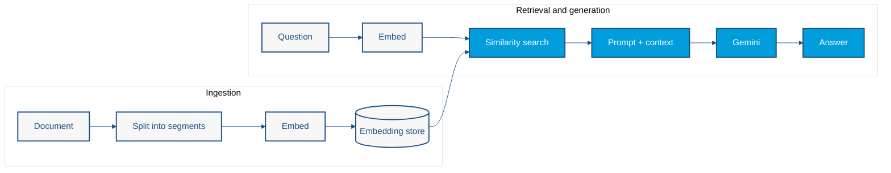

# Lab 3 — Retrieval-Augmented Generation

<span class="lab-meta">Duration: 45 minutes · Enterprise Java · LangChain4j · CDI</span>

*Ground AI answers in your own documents using a local embedding model, an in-memory vector store, and a declarative retriever.*

## The Problem: The Model Does Not Know Your Data

A language model knows only what it saw during training. Ask it about your company's 2026 remote-work policy and it can only guess, or invent a confident answer. Pasting every document into every prompt does not scale either.

## Our Goal

Build an **HR policy assistant** that answers from a small policy document:

```text
User Query → Retrieval → Relevant Context → LLM → Response
```

## Learning objectives

By the end of this lab you will be able to:

- Explain the RAG flow end to end
- Describe documents, segments, embeddings, and vector similarity
- Ingest a document into an embedding store
- Configure a retriever (`maxResults`, `minScore`) and attach it to an AI service
- Produce grounded responses and recognize their limits

## Prerequisites

- Completed [Lab 2](lab2-memory.md) and a working `.env` setup (see [Getting Started](../getting-started.md))
- Nothing else to install: the embedding model runs inside the JVM

## Architecture: Ingestion and Retrieval

RAG has two phases. **Ingestion** prepares knowledge once; **retrieval and generation** happen on every question.



Key ideas:

- An **embedding** is a vector of numbers that represents the meaning of a text. Similar texts have nearby vectors.
- A **segment** is a small chunk of a document. Retrieving chunks keeps the prompt small and focused.
- The **retriever** embeds the question and returns the closest segments above a minimum score.
- The **chat model** (Gemini, configured in Lab 0) only writes the answer; the **embedding model** is a separate, local model.

## Step-by-step implementation

You will create three classes in `src/main/java/os/expert/lab3/`.

### Step 1 — Create the AI interface

Create `HRPolicyAgent.java`. It is a plain interface; the RAG behavior is attached later by the factory.

```java
package os.expert.lab3;

public interface HRPolicyAgent {
    String ask(String question);
}
```

Unlike Labs 1 and 2, this interface has no `@RegisterAIService`. You will build it explicitly in a CDI producer so you can attach the retriever.

### Step 2 — Create the RAG factory

Create `RagArchitectureFactory.java`. It produces four CDI beans: the embedding model, the vector store, the retriever, and the agent.

```java
package os.expert.lab3;

import dev.langchain4j.data.segment.TextSegment;
import dev.langchain4j.model.chat.ChatModel;
import dev.langchain4j.model.embedding.EmbeddingModel;
import dev.langchain4j.model.embedding.onnx.allminilml6v2.AllMiniLmL6V2EmbeddingModel;
import dev.langchain4j.rag.content.retriever.ContentRetriever;
import dev.langchain4j.rag.content.retriever.EmbeddingStoreContentRetriever;
import dev.langchain4j.service.AiServices;
import dev.langchain4j.store.embedding.EmbeddingStore;
import dev.langchain4j.store.embedding.inmemory.InMemoryEmbeddingStore;
import jakarta.enterprise.context.ApplicationScoped;
import jakarta.enterprise.inject.Produces;

@ApplicationScoped
public class RagArchitectureFactory {


    @Produces
    @ApplicationScoped
    public EmbeddingModel createEmbeddingModel() {
        // A fast, local model for translating text to vectors
        // Outputs a 384-dimensional vector
        return new AllMiniLmL6V2EmbeddingModel();
    }

    @Produces
    @ApplicationScoped
    public EmbeddingStore<TextSegment> createVectorDatabase() {
        // For production, this would be PgVector, Milvus, Qdrant, etc.
        return new InMemoryEmbeddingStore<>();
    }

    @Produces
    @ApplicationScoped
    public ContentRetriever createRetriever(EmbeddingStore<TextSegment> store, EmbeddingModel model) {
        // The architectural bridge that searches the DB based on the query vector
        return EmbeddingStoreContentRetriever.builder()
                .embeddingStore(store)
                .embeddingModel(model)
                .maxResults(3) // Fetch the top 3 most relevant chunks
                .minScore(0.7) // Strict boundary: Ignore low-confidence matches
                .build();
    }

    @Produces
    @ApplicationScoped
    public HRPolicyAgent createAgent(ChatModel chatModel, ContentRetriever retriever) {
        // Binds the RAG pipeline to the Agent
        return AiServices.builder(HRPolicyAgent.class)
                .chatModel(chatModel)
                .contentRetriever(retriever)
                .build();
    }
}
```

What each producer does:

| Producer | Role |
|---|---|
| `EmbeddingModel` | `AllMiniLmL6V2EmbeddingModel` runs locally and outputs 384-dimensional vectors. No API call is needed. |
| `EmbeddingStore<TextSegment>` | `InMemoryEmbeddingStore` keeps vectors in the JVM heap. |
| `ContentRetriever` | Embeds the question, returns up to `maxResults(3)` segments scoring at least `minScore(0.7)`. |
| `HRPolicyAgent` | `AiServices.builder(...)` combines the `ChatModel` (created from your Gemini configuration) with the retriever. |

!!! note "Where does the ChatModel come from?"
    You do not create it. The LangChain4j CDI integration builds it from `microprofile-config.properties`, exactly as in Labs 0 to 2.

### Step 3 — Ingest and ask

Create `RagMain.java`. It ingests one document, then asks a question.

```java
package os.expert.lab3;

import dev.langchain4j.data.document.Document;
import dev.langchain4j.data.document.splitter.DocumentSplitters;
import dev.langchain4j.data.segment.TextSegment;
import dev.langchain4j.model.embedding.EmbeddingModel;
import dev.langchain4j.store.embedding.EmbeddingStore;
import dev.langchain4j.store.embedding.EmbeddingStoreIngestor;
import jakarta.enterprise.inject.se.SeContainer;
import jakarta.enterprise.inject.se.SeContainerInitializer;
import jakarta.enterprise.util.TypeLiteral;

public class RagMain {

    public static void main(String[] args) {
        try (SeContainer container = SeContainerInitializer.newInstance().initialize()) {

            // 1. Fetch dependencies from CDI
            EmbeddingModel embeddingModel = container.select(EmbeddingModel.class).get();
            EmbeddingStore<TextSegment> vectorDb = container.select(new TypeLiteral<EmbeddingStore<TextSegment>>() {}).get();
            HRPolicyAgent agent = container.select(HRPolicyAgent.class).get();

            // ==========================================
            // PHASE 1: DATA INGESTION
            // ==========================================
            System.out.println("Ingesting HR Policies into Vector DB...");

            Document document = Document.from(
                    "Company Policy Update 2026: Remote work is permitted on Tuesdays and Thursdays. " +
                            "The annual hardware stipend has been increased to $1,500. " +
                            "Core hours are 10:00 AM to 3:00 PM EST."
            );

            // Chunk the document and store the embeddings
            EmbeddingStoreIngestor ingestor = EmbeddingStoreIngestor.builder()
                    .documentSplitter(DocumentSplitters.recursive(100, 10)) // 100 tokens, 10 token overlap
                    .embeddingModel(embeddingModel)
                    .embeddingStore(vectorDb)
                    .build();

            ingestor.ingest(document);

            // ==========================================
            // PHASE 2: RETRIEVAL & GENERATION
            // ==========================================
            System.out.println("User: What is my hardware stipend limit?");

            // The framework automatically takes this String, embeds it, queries the DB,
            // appends the fact to the prompt, and asks GPT-4 to generate the answer.
            String response = agent.ask("What is my hardware stipend limit?");

            System.out.println("Agent: " + response);
        }
    }
}
```

!!! tip "Comments"
    The comments are explanations. You can shorten them. Note that the answering model in this workshop is Gemini, not the GPT model mentioned in the last comment.

## Ingestion

`EmbeddingStoreIngestor` performs three steps for you: split the `Document`, embed each segment, and store the vectors.

- `DocumentSplitters.recursive(100, 10)` creates segments of up to 100 tokens with a 10-token overlap, so a fact cut at a boundary still appears in a neighbouring segment.
- The store is in memory, so ingestion runs on **every start** and the data is lost on exit.

## Retrieval

When you call `agent.ask(...)`, the framework:

1. embeds the question with the same embedding model,
2. finds the closest segments in the store,
3. drops those below `minScore(0.7)`,
4. adds the survivors to the prompt as context,
5. asks Gemini to answer.

If no segment passes `minScore`, the model receives no extra context and may answer from general knowledge or refuse. Grounding is only as good as retrieval.

## Run the lab

Run `os.expert.lab3.RagMain` from IntelliJ (working directory: the repository root, so `.env` is found), or build and run from a terminal:

```bash
mvn clean verify
mvn dependency:build-classpath -Dmdep.outputFile=/tmp/cp.txt
java -cp target/classes:$(cat /tmp/cp.txt) os.expert.lab3.RagMain
```

## Expected results

```text
Ingesting HR Policies into Vector DB...
User: What is my hardware stipend limit?
Agent: Your annual hardware stipend limit is $1,500.
```

Wording can vary between runs, but the answer should contain **$1,500**, a fact that exists only in your document. Weld and LangChain4j also print INFO log lines; they are harmless.

## Architectural trade-offs

### Advantages

- Answers can be grounded in private, current data without retraining a model.
- Knowledge changes by re-ingesting documents, not by changing code.
- The embedding model runs locally, with no extra API or credentials.

### Limitations

- **Retrieval quality:** chunk size, overlap, `maxResults` and `minScore` strongly affect answers. A too-strict `minScore` returns nothing; a too-loose one adds noise.
- **Freshness:** the index must be rebuilt when documents change.
- **Persistence:** the in-memory store is lost on every restart.
- **Scale:** one tiny document is not representative of real corpora.
- **Not a guarantee:** a retrieved context reduces, but does not eliminate, unsupported answers.

## Try It Yourself

Optional, and not required to finish the lab:

1. Ask *"When can I work remotely?"* and *"What are the core hours?"*
2. Ask something that is not in the document, such as the dress code, and observe the response.
3. Change `minScore` to `0.9`, then `0.3`, and compare behavior.
4. Change the splitter to `recursive(30, 5)` and observe how retrieval changes.

## Going Further: RAG with MongoDB

Lab 3 deliberately uses a **local embedding model** and an **in-memory embedding store** so RAG is accessible without additional infrastructure. Enterprise RAG systems, however, often need persistent storage, document management, operational integration, and scalable retrieval.

The article [Introduction to Retrieval-Augmented Generation with Java and MongoDB](https://foojay.io/today/introduction-to-retrieval-augmented-generation-with-java-and-mongodb/) demonstrates a more advanced HR policy RAG architecture using Java, LangChain4j, CDI, and MongoDB Atlas.

- **Lab 3:** local embeddings and an in-memory vector store.
- **Advanced article:** integration with MongoDB Atlas and persistent enterprise data.

!!! note "MongoDB is optional"
    You do not need MongoDB, Atlas credentials, Docker, or any external database to complete this workshop. The article is additional reading.

### Optional architecture comparison

| Aspect | Lab 3 | Advanced article |
|---|---|---|
| Use case | HR policy assistant | HR policy assistant |
| Java integration | LangChain4j + CDI | LangChain4j + CDI |
| Vector storage | In-memory | MongoDB Atlas |
| Infrastructure | Local JVM + Gemini | MongoDB Atlas + LLM provider |
| Persistence | No | Yes |
| Primary goal | Understand the RAG pipeline | Explore enterprise RAG integration |

Changing the vector store does not fundamentally change the RAG pattern: ingestion, retrieval, and generation keep conceptually similar responsibilities. Production requirements do make each part more complex, and the two implementations do not share identical configuration, APIs, or deployment requirements.

## More resources

- [LangChain4j RAG](https://docs.langchain4j.dev/tutorials/rag/)
- [Gemini embeddings](https://ai.google.dev/gemini-api/docs/embeddings)

---

[Continue to Lab 4](lab4-reflection.md)
