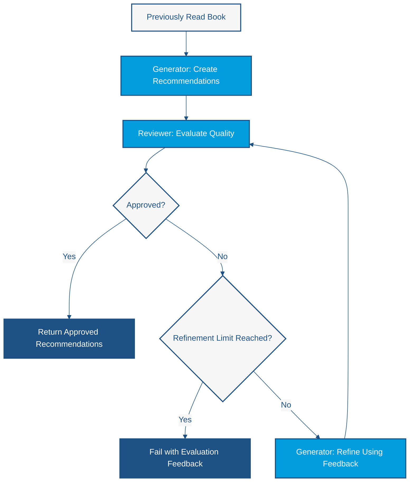

# Lab 4 — Reflection Architecture: Generating, Evaluating, and Refining AI Responses

<span class="lab-meta">Duration: 30 minutes · Enterprise Java · LangChain4j · CDI</span>

*Build an AI-powered book recommendation system that improves its answers through structured evaluation and bounded feedback loops.*

## The Problem: Can We Trust the First AI Response?

In [Lab 1](lab1-hello-world.md) we built a book recommendation application. Given a previously read book, Gemini suggested more books to continue the reader's learning journey. But the application **accepted the first model response**. That creates several risks:

- Recommendations may be too similar to each other.
- Suggested books may not provide meaningful progression.
- Recommendations may repeat the original book.
- Titles or authors may be inaccurate.
- The model may overlook requirements.

Traditional software often validates intermediate results before accepting them. Can we apply a similar idea to AI-generated content? That is the motivation for **Reflection**.

### The Reflection pattern

Reflection is an architectural pattern in which generated output is **evaluated** and, if necessary, **revised based on feedback**. The core loop is:

**Generate → Evaluate → Refine → Evaluate again**

The process stops when:

- the evaluator **approves** the result, or
- a predefined **refinement limit** is reached.

Reflection is not the same as asking an LLM for a longer answer. It introduces explicit evaluation criteria, feedback, and iterative improvement.

!!! warning "Evaluation is not verification"
    An LLM evaluator is a second opinion, not independent factual verification. It can approve a wrong answer or reject a good one.

## Our Goal

Build an application that:

1. Receives the title and author of a previously read book.
2. Generates three technical book recommendations.
3. Evaluates them against defined quality criteria.
4. Returns approved recommendations.
5. If rejected, supplies the feedback to the generator.
6. Generates an improved version.
7. Repeats the evaluation, with a bounded number of attempts.
8. Reports failure explicitly if no version is approved.

The demonstration uses **Clean Code — Robert C. Martin** and targets an experienced software engineer's learning journey.

### Learning objectives

By the end of this lab you will understand:

- The Reflection architecture pattern
- Generator and evaluator responsibilities
- Feedback-driven iteration
- How LangChain4j declarative AI Services express different AI roles
- How `@SystemMessage`, `@UserMessage`, and `@V` work
- How Java records represent structured AI output
- How CDI injects multiple AI Services into an orchestrator
- How Java controls stopping conditions
- Why LLM evaluation is useful but imperfect
- The cost and latency trade-offs of repeated model calls

## Prerequisites

- Completed [Lab 3](lab3-rag.md) (or at least [Lab 1](lab1-hello-world.md), whose conventions we reuse)
- Java 21, Maven, and a working Gemini configuration with `.env` (see [Getting Started](../getting-started.md))
- No additional API key or infrastructure

## Architecture: The Reflection Feedback Loop



### The components

| Component | Responsibility |
|---|---|
| `RecommendationGenerator` | Generates initial recommendations and improves them using feedback |
| `RecommendationReviewer` | Evaluates recommendations against quality criteria and returns an approval decision |
| `ReflectionService` | Controls the workflow: tracks attempts, enforces the maximum number of refinements, decides to return or fail |
| Google Gemini | The language model behind both AI Services |
| Java records | The structured data exchanged between components |

### Comparison with Lab 1

- **Lab 1:** Input → Generate → Return. A forward-only, developer-controlled DAG.
- **Lab 4:** Input → Generate → Evaluate → Possibly Refine → Evaluate → Return or Fail.

Lab 4 introduces a **feedback cycle**, so it is no longer a DAG. The Java orchestrator remains in control of iteration and stopping conditions. This is not an unbounded autonomous system.

## Files You Will Create

```text
src/main/java/os/expert/lab4/
├── BookRecommendation.java
├── RecommendationDraft.java
├── RecommendationEvaluation.java
├── RecommendationGenerator.java
├── RecommendationReviewer.java
├── ReflectionService.java
└── ReflectionApp.java
```

!!! important "These files are not in the published repository"
    The repository contains only `package-info.java` for this package. You create all seven classes in the steps below. Each listing is complete, including the package declaration and imports.

## Step-by-step implementation

### Step 1 — Model a book recommendation

**Why:** the AI returns structured data, not free text. **Path:** `src/main/java/os/expert/lab4/BookRecommendation.java`

```java
package os.expert.lab4;

public record BookRecommendation(
        String title,
        String author,
        String reason
) {
}
```

- `title` and `author` identify the book.
- `reason` explains how the book relates to the reader's learning journey. A bare title is hard to judge; a reason lets both the user and the reviewer assess *progression*.

### Step 2 — Represent the generated draft

**Path:** `src/main/java/os/expert/lab4/RecommendationDraft.java`

```java
package os.expert.lab4;

import java.util.List;

public record RecommendationDraft(
        List<BookRecommendation> books
) {
}
```

The generator returns a structured collection of `BookRecommendation`. It is called a **draft** on purpose: it has not yet passed evaluation.

### Step 3 — Represent evaluation feedback

**Path:** `src/main/java/os/expert/lab4/RecommendationEvaluation.java`

```java
package os.expert.lab4;

public record RecommendationEvaluation(
        boolean approved,
        String feedback
) {
}
```

- `approved` — whether the reviewer accepts the recommendations against its criteria.
- `feedback` — why they were approved, or what should improve.

The feedback becomes the input to the next refinement cycle. This record connects evaluation to generation without the evaluator having to produce replacement recommendations.

**Checkpoint:** the three records compile with no dependencies besides `java.util.List`.

### Step 4 — Create the Recommendation Generator

**Why:** this AI Service plays the *generator* role. **Path:** `src/main/java/os/expert/lab4/RecommendationGenerator.java`

```java
package os.expert.lab4;

import dev.langchain4j.cdi.spi.RegisterAIService;
import dev.langchain4j.service.SystemMessage;
import dev.langchain4j.service.UserMessage;
import dev.langchain4j.service.V;
import jakarta.enterprise.context.ApplicationScoped;

@RegisterAIService(scope = ApplicationScoped.class)
public interface RecommendationGenerator {

    @SystemMessage("""
        You are a technical book recommendation specialist
        for experienced software engineers.

        Your responsibility is to recommend exactly three books
        that help the reader progress in their learning journey.

        Prioritize:
        - Conceptual progression.
        - Complementary knowledge.
        - Software architecture and design skills.
        - Increasing technical depth.

        RULES:
        - Never recommend the original book.
        - Avoid duplicate recommendations.
        - Recommend real, published books.
        - Do not invent book titles or authors.
        - Provide a concise reason for each recommendation.
        - Return exactly three recommendations.
        """)
    @UserMessage("""
        I have just finished reading "{{title}}" by {{author}}.

        Recommend three books that would help me
        continue my software engineering learning journey.
        """)
    RecommendationDraft generate(
            @V("title") String title,
            @V("author") String author
    );

    @SystemMessage("""
        You are a technical book recommendation specialist.

        Your responsibility is to improve previously generated
        recommendations based on evaluator feedback.

        RULES:
        - Address every issue identified by the evaluator.
        - Recommend exactly three books.
        - Never recommend the original book.
        - Avoid duplicates.
        - Recommend real, published books.
        - Provide a meaningful reason for each recommendation.
        - Return only the improved recommendations.
        """)
    @UserMessage("""
        ORIGINAL BOOK:
        "{{title}}" by {{author}}

        PREVIOUS RECOMMENDATIONS:
        {{previousRecommendations}}

        EVALUATOR FEEDBACK:
        {{feedback}}

        Generate an improved set of three book recommendations
        that addresses the evaluator's concerns.
        """)
    RecommendationDraft refine(
            @V("title") String title,
            @V("author") String author,
            @V("previousRecommendations") String previousRecommendations,
            @V("feedback") String feedback
    );
}
```

**Declarative AI Services.** You write only an interface. LangChain4j generates the implementation: it builds the prompt, calls Gemini, and parses the JSON response into `RecommendationDraft`. `@RegisterAIService(scope = ApplicationScoped.class)` (from `dev.langchain4j.cdi.spi`) tells the LangChain4j CDI integration to register the interface as an application-scoped bean, so it can be injected.

**`@SystemMessage`** sets the standing instructions. The generator must recommend three real books, prioritize conceptual progression, avoid duplicates, never recommend the original book, and explain each choice. The `refine` method has **different** instructions: its job is to *improve previous recommendations* and address every issue the evaluator raised.

**`@UserMessage` and `@V`** define the per-call prompt. `@V("title")` and `@V("author")` bind method arguments to the `{{title}}` and `{{author}}` placeholders, so the orchestrator never builds prompt strings by hand.

**`generate` versus `refine`.** `generate` receives the title and author. `refine` additionally receives the **previous recommendations** and the **evaluator's feedback**; without them the model could not know what to change or why the draft was rejected.

### Step 5 — Create the Recommendation Reviewer

**Why:** the second AI Service plays the *evaluator* role and must not generate anything. **Path:** `src/main/java/os/expert/lab4/RecommendationReviewer.java`

```java
package os.expert.lab4;

import dev.langchain4j.cdi.spi.RegisterAIService;
import dev.langchain4j.service.SystemMessage;
import dev.langchain4j.service.UserMessage;
import dev.langchain4j.service.V;
import jakarta.enterprise.context.ApplicationScoped;

@RegisterAIService(scope = ApplicationScoped.class)
public interface RecommendationReviewer {

    @SystemMessage("""
        You are a strict technical book recommendation reviewer.

        Evaluate recommendations for experienced
        software engineers.

        EVALUATION CRITERIA:

        1. RELEVANCE
           The recommendations should relate to the original book.

        2. PROGRESSION
           The recommendations should offer meaningful next steps
           in the reader's learning journey.

        3. DIVERSITY
           The recommendations should provide complementary
           perspectives rather than repeating the same concepts.

        4. ACCURACY
           Titles and authors should refer to real publications.
           Do not claim external verification you have not performed.

        5. COMPLETENESS
           There must be exactly three distinct recommendations,
           each containing a title, author, and explanation.

        APPROVAL RULES:
        - Approve only when all criteria are satisfied.
        - Otherwise reject the recommendations.
        - Provide specific, actionable feedback when rejecting.
        - Do not generate new recommendations.
        - Keep feedback concise.
        """)
    @UserMessage("""
        ORIGINAL BOOK:
        "{{title}}" by {{author}}

        RECOMMENDATIONS TO EVALUATE:
        {{recommendations}}

        Evaluate the recommendations against your criteria.

        Return:
        - approved: true if acceptable, otherwise false.
        - feedback: your explanation and suggestions.
        """)
    RecommendationEvaluation evaluate(
            @V("title") String title,
            @V("author") String author,
            @V("recommendations") String recommendations
    );
}
```

The system message defines five criteria:

1. **Relevance** — the books relate to the original one.
2. **Progression** — they are meaningful next steps.
3. **Diversity** — they offer complementary perspectives, not repetition.
4. **Accuracy** — titles and authors refer to real publications.
5. **Completeness** — exactly three distinct books, each with title, author, and explanation.

The reviewer returns a `RecommendationEvaluation` (decision plus feedback). Its `@UserMessage` receives the original title and author and the recommendations to evaluate, bound with `@V`.

!!! warning "Important limitation"
    The reviewer is an LLM. It might approve a nonexistent book or reject a valid one. The system has no verified book catalog, and a second LLM call does not guarantee correctness. The prompt even tells the model not to claim verification it has not performed.

### Step 6 — Implement the Reflection orchestrator

**Why:** someone has to decide whether to continue. That decision belongs in deterministic Java, not in a prompt. **Path:** `src/main/java/os/expert/lab4/ReflectionService.java`

```java
package os.expert.lab4;

import jakarta.enterprise.context.ApplicationScoped;
import jakarta.inject.Inject;

@ApplicationScoped
public class ReflectionService {

    private static final int MAX_REFINEMENTS = 2;

    @Inject
    private RecommendationGenerator generator;

    @Inject
    private RecommendationReviewer reviewer;

    public RecommendationDraft recommend(String title, String author) {

        System.out.println("\n[GENERATOR] Creating recommendations...");

        RecommendationDraft draft = generator.generate(title, author);

        for (int attempt = 0; attempt <= MAX_REFINEMENTS; attempt++) {

            System.out.printf(
                    "%n[EVALUATOR] Reviewing attempt %d...%n",
                    attempt + 1
            );

            RecommendationEvaluation evaluation = reviewer.evaluate(
                    title,
                    author,
                    formatRecommendations(draft)
            );

            System.out.println(
                    "[EVALUATOR] Approved: " + evaluation.approved()
            );

            System.out.println(
                    "[EVALUATOR] Feedback: " + evaluation.feedback()
            );

            if (evaluation.approved()) {
                System.out.println(
                        "\n[REFLECTION] Recommendations approved."
                );
                return draft;
            }

            if (attempt == MAX_REFINEMENTS) {
                throw new IllegalStateException(
                        "Recommendations were not approved after "
                                + (MAX_REFINEMENTS + 1)
                                + " evaluations. Last feedback: "
                                + evaluation.feedback()
                );
            }

            System.out.println(
                    "\n[REFLECTION] Refining recommendations..."
            );

            draft = generator.refine(
                    title,
                    author,
                    formatRecommendations(draft),
                    evaluation.feedback()
            );
        }

        throw new IllegalStateException(
                "Reflection terminated without an approved result."
        );
    }

    private String formatRecommendations(RecommendationDraft draft) {

        if (draft == null || draft.books() == null) {
            return "No recommendations generated.";
        }

        StringBuilder result = new StringBuilder();

        int index = 1;

        for (BookRecommendation book : draft.books()) {

            if (book == null) {
                result.append(index++)
                        .append(". Invalid recommendation\n");
                continue;
            }

            result.append(index++)
                    .append(". Title: ")
                    .append(book.title())
                    .append("\n   Author: ")
                    .append(book.author())
                    .append("\n   Reason: ")
                    .append(book.reason())
                    .append("\n");
        }

        return result.toString();
    }
}
```

**Responsibilities.** Invoke the generator and reviewer, interpret approval, pass feedback into refinement, enforce the iteration limit, return approved results, and fail otherwise. The AI's probabilistic judgments are separated from the application's deterministic control logic.

**CDI.** `@ApplicationScoped` makes the service a bean. `@Inject` supplies the two AI Services, which are CDI-managed LangChain4j beans.

**Iteration limit.** `MAX_REFINEMENTS = 2` and the loop `for (int attempt = 0; attempt <= MAX_REFINEMENTS; attempt++)` mean:

| Quantity | Value |
|---|---|
| Initial generations | 1 |
| Maximum additional refinements | 2 |
| Maximum evaluations | 3 |
| Maximum generation calls (`generate` + `refine`) | 3 |

The loop ends early when the reviewer approves.

**Evaluation.** `reviewer.evaluate(title, author, formatRecommendations(draft))` passes the original request together with the draft, so the reviewer judges relevance to the book that was actually read.

**Approval.** `if (evaluation.approved()) return draft;` ends the cycle.

**Refinement.** `generator.refine(...)` receives the title, author, the previous recommendations, and the reviewer's feedback. The new draft replaces the old one and is evaluated again.

**Failure.** When the last permitted evaluation is rejected, the service throws `IllegalStateException` with the final feedback. A rejected draft is never presented as approved. The final `throw` after the loop is a defensive guard that should not be reachable.

**Formatting.** `formatRecommendations` converts the structured draft into text for the prompts. It is a serialization boundary, not another AI service, and it tolerates a null draft or null entries.

### Step 7 — Create the application entry point

**Path:** `src/main/java/os/expert/lab4/ReflectionApp.java`

```java
package os.expert.lab4;

import jakarta.enterprise.inject.se.SeContainer;
import jakarta.enterprise.inject.se.SeContainerInitializer;

public class ReflectionApp {

    public static void main(String[] args) {

        try (SeContainer container =
                     SeContainerInitializer.newInstance().initialize()) {

            ReflectionService service =
                    container.select(ReflectionService.class).get();

            System.out.println("""

                    ==========================================
                       LAB 4 - REFLECTION ARCHITECTURE
                    ==========================================
                    """);

            RecommendationDraft recommendations = service.recommend(
                    "Clean Code",
                    "Robert C. Martin"
            );

            System.out.println("\nFINAL RECOMMENDATIONS");
            System.out.println("=====================");

            recommendations.books().forEach(book -> {
                System.out.println("\nTitle: " + book.title());
                System.out.println("Author: " + book.author());
                System.out.println("Why: " + book.reason());
            });
        }
    }
}
```

The app starts Weld SE, looks up `ReflectionService` through CDI, calls `recommend("Clean Code", "Robert C. Martin")`, prints each approved book, and closes the container when the `try` block exits. The Gemini model comes from the configuration you set up in [Getting Started](../getting-started.md); nothing else is needed.

## Run the Reflection Application

1. Open the Maven project in IntelliJ IDEA.
2. Verify the project SDK is Java 21.
3. Verify `GEMINI_API_KEY` is in `.env` at the repository root and that the model in `microprofile-config.properties` is available to your key.
4. Use a model that supports structured (JSON) responses, because both services return records.
5. Create all seven classes from the steps above.
6. Run `mvn clean verify`.
7. Run `os.expert.lab4.ReflectionApp` (working directory: the repository root).
8. Watch the `[GENERATOR]`, `[EVALUATOR]`, and `[REFLECTION]` messages.

The project has no Maven exec plugin. To run from a terminal:

```bash
mvn dependency:build-classpath -Dmdep.outputFile=/tmp/cp.txt
java -cp target/classes:$(cat /tmp/cp.txt) os.expert.lab4.ReflectionApp
```

!!! tip "Troubleshooting"
    - **401/403 or "API key" errors:** `.env` is missing or the working directory is not the repository root.
    - **404 or 503 for the model:** choose another available Gemini model.
    - **Timeouts:** each run makes at least two model calls; the configured timeout applies to each.
    - **JSON/parsing errors:** retry, or try a different model. Structured output can fail.
    - **`IllegalStateException`:** the reviewer rejected every draft; see Scenario C.

## Expected results

Model output is nondeterministic, so runs differ. The application can take any of three paths. Do not expect every run to show a refinement.

### Scenario A — Approved immediately

This path was observed in a real run (the feedback text is shortened here):

```text
[GENERATOR] Creating recommendations...

[EVALUATOR] Reviewing attempt 1...
[EVALUATOR] Approved: true
[EVALUATOR] Feedback: All criteria are met. ...

[REFLECTION] Recommendations approved.

FINAL RECOMMENDATIONS
=====================

Title: Refactoring: Improving the Design of Existing Code
Author: Martin Fowler
Why: ...
```

### Scenario B — Refinement required (illustrative)

```text
[GENERATOR] Creating recommendations...

[EVALUATOR] Reviewing attempt 1...
[EVALUATOR] Approved: false

[REFLECTION] Refining recommendations...

[EVALUATOR] Reviewing attempt 2...
[EVALUATOR] Approved: true

[REFLECTION] Recommendations approved.

FINAL RECOMMENDATIONS
...
```

### Scenario C — Refinement limit reached (illustrative)

The reviewer rejects all three evaluated drafts and the application throws:

```text
Exception ... java.lang.IllegalStateException: Recommendations were not approved after 3 evaluations. Last feedback: ...
```

Scenarios B and C were not reproduced in testing; they are shown to explain the control flow.

## Architectural Trade-offs

### Benefits

- Feedback-driven improvement
- Explicit quality criteria
- Clear separation of generation and evaluation
- Bounded execution
- Reusable CDI-managed components
- Structured Java contracts

### Limitations

- Additional model calls increase **latency**.
- Additional calls increase **API cost**.
- The reviewer may approve incorrect information.
- Generator and reviewer may share the same model biases.
- Evaluation may vary between executions.
- Refinement can make an answer worse.
- Structured output parsing can fail.
- Strict criteria may cause repeated rejection.
- The implementation does not independently verify that books exist.

Reflection improves how generated content is evaluated; it does **not** guarantee factual correctness. Enterprise applications may also need deterministic validation and external verification, such as checking titles against a catalog.

## Try It Yourself

### Challenge A — Force a stricter review

Edit the `RecommendationReviewer` system message so recommendations must meet more demanding architectural-progression requirements (for example, at least one book must cover distributed systems). Run again and observe whether the first draft is rejected and whether refinement changes the books. Stricter instructions can encourage rejection but do not guarantee it on every run.

### Challenge B — Change the refinement limit

Change `MAX_REFINEMENTS = 2` to `MAX_REFINEMENTS = 1` and discuss:

- How many model calls can now occur? (At most 2 generation calls and 2 evaluations.)
- What happens if the reviewer rejects both drafts?
- What does this mean for latency and cost?
- When should an enterprise application stop retrying?

## How Does Reflection Change the Architecture?

| Lab | Architectural capability |
|---|---|
| Lab 1 | Deterministic DAG orchestration |
| Lab 2 | Session-specific conversational memory |
| Lab 3 | External knowledge retrieval through RAG |
| Lab 4 | Feedback-driven evaluation and refinement |

Reflection changes the control-flow structure: the application introduces iterative evaluation and refinement. Yet the Java code still enforces the loop and its limits. The progression is educational, not a strict ladder of increasing AI autonomy. In [Lab 5](lab5-planning.md) you will explore planning and model-directed tool choices.

## Further reading

- [LangChain4j AI Services](https://docs.langchain4j.dev/tutorials/ai-services/)
- [LangChain4j documentation](https://docs.langchain4j.dev/)

This lab implements the loop directly in Java instead of using an extra orchestration framework. Alternative designs include deterministic validators, scoring models, and dedicated evaluator pipelines; they are outside the required lab.

---

[Back to Lab 3](lab3-rag.md) · [Continue to Lab 5](lab5-planning.md)
