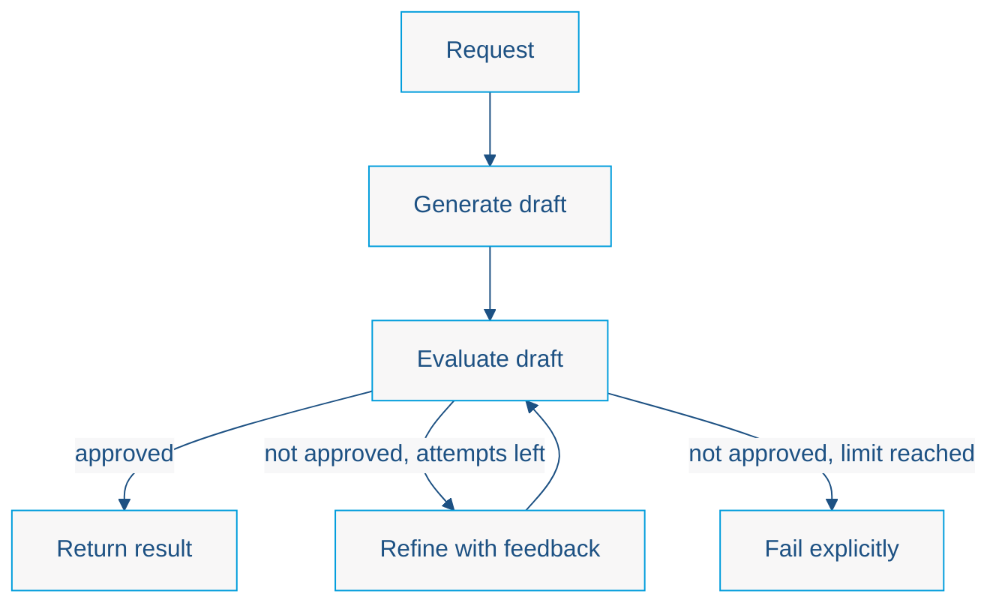

# Lab 4 — Reflection Architecture

Duration: 30 minutes · Enterprise Java · LangChain4j · CDI

!!! note "Under development"
    This page outlines the lab. The full step-by-step tutorial, with every class listed for you to create, is being written.

## The Problem

A single model call produces a single draft, and nothing checks it. Drafts can be off-topic, repetitive, or miss your criteria. We want the application to notice that and improve the result.

## Our Goal

Build an AI-powered recommendation system that **generates, evaluates, and refines** its own output, with a bounded number of attempts.

## Learning objectives

- Describe the generate → evaluate → refine loop
- Express evaluation criteria and receive a structured verdict (approved or not, plus feedback)
- Bound the number of iterations and handle the case where the output is never approved
- Recognize the limits of LLM-based evaluation

## Architectural concept

A generator produces a draft. A separate reviewer evaluates it against criteria and returns structured feedback. If the draft is not approved, the Java code asks the generator to refine it, up to a fixed maximum, and fails explicitly if approval is never reached.

Unlike Labs 1-3, this flow has a **cycle** (evaluate → refine → evaluate), so it is no longer a DAG. The loop is still controlled by Java code with a hard limit: reflection adds feedback-driven iteration, not open-ended autonomy.

!!! warning
    An LLM evaluator can be wrong or inconsistent. Approval from a model is a signal, not proof of correctness.

## Next

[Back to Lab 3](lab3-rag.md) · [Continue to Lab 5](lab5-planning.md)
