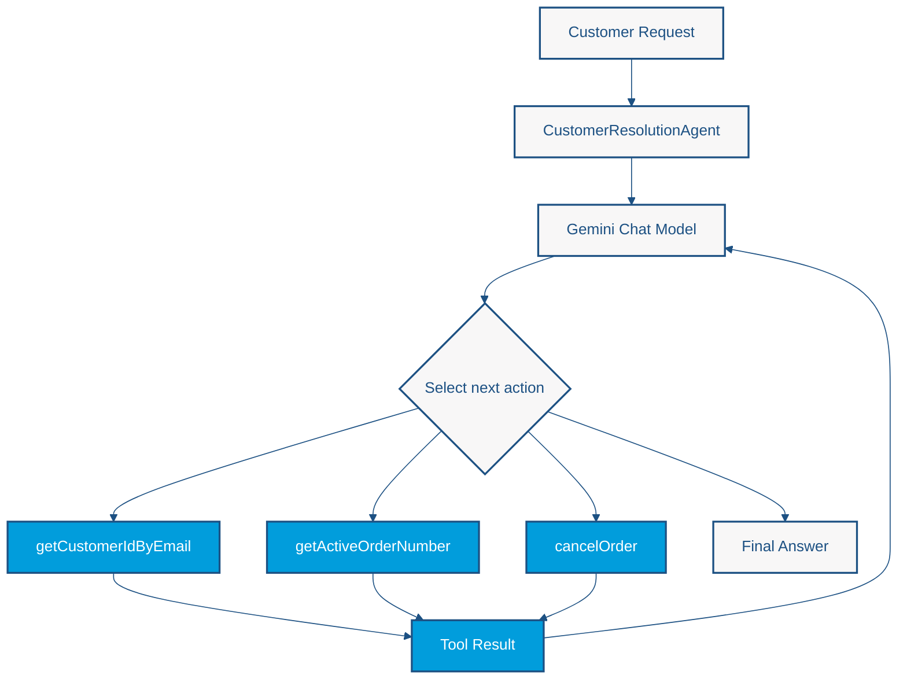

# Lab 5 — Planning and Tool Execution: AI-Driven Customer Support

<span class="lab-meta">Duration: 40 minutes · Enterprise Java · LangChain4j · CDI</span>

*Build an AI assistant that coordinates enterprise tools to resolve a multi-step customer request.*

!!! warning "What this lab is, and what it is not"
    This lab sits under **Planning Architecture** for continuity, but the implementation is **model-directed tool calling with a ReAct-like execution loop**. Gemini chooses which registered tool to call next, observes the result, and decides what to do. There is **no separate planner, plan object, plan validation stage, or plan-execution engine**. [From Tool Calling to Explicit Planning](#from-tool-calling-to-explicit-planning) explains how a plan-first design would differ.

## The Problem: One Request, Multiple Business Operations

A customer writes to an online retailer:

> "Hi, my email is alice@test.com. Please cancel my current order."

It sounds simple. Completing it involves several enterprise operations. The application must:

1. Identify the customer using their email address.
2. Retrieve the customer's internal ID.
3. Find an active order for that customer.
4. Cancel the relevant order.
5. Retrieve the cancellation and refund status.
6. Communicate the result.

The operations **depend on each other**: the order lookup needs the customer ID, and the cancellation needs the order number.

A traditional system can hard-code this workflow. But what happens when other requests need different operations: *"Where is my order?"*, *"Change my address"*, *"Why was I charged twice?"*? Hard-coding every path does not scale.

**Model-directed tool selection** offers another approach. The application registers its capabilities as tools, and the LLM selects among them using the request and the results of earlier tool calls.

!!! note "The trade-off"
    The model now has more **operational influence**. A wrong choice can touch real business data, so **business validation and security matter more**, not less.

## Our Goal

Build an AI-powered customer support application that:

- Accepts a natural-language customer request.
- Exposes enterprise operations as LangChain4j **tools**.
- Allows Gemini to select tools.
- Passes tool results back into the model interaction.
- Supports dependent tool calls.
- Returns a customer-friendly resolution.
- Uses CDI to integrate the AI Service and the enterprise tools.

The demonstration uses three tools: `getCustomerIdByEmail`, `getActiveOrderNumber`, and `cancelOrder`.

### Learning objectives

By the end of this lab you will understand:

- Model-directed tool calling
- The role of `@Tool`, and how LangChain4j exposes Java methods to an LLM
- How CDI integrates tool implementations
- How `@RegisterAIService` registers the agent, and how `@SystemMessage` sets behavioral boundaries
- How the result of one tool can inform later tool calls
- The difference between model decisions and deterministic tool execution
- The difference between ReAct-like tool calling and explicit planning
- Why tool authorization must remain in Java
- How tool-calling loops affect latency and reliability

## Prerequisites

- Completed [Lab 4](lab4-reflection.md) and a working `.env` setup (see [Getting Started](../getting-started.md))
- Nothing else to install

## Architecture: The Tool-Calling Loop



| Component | Responsibility |
|---|---|
| **AI Service** (`CustomerResolutionAgent`) | Receives the request and coordinates the model interaction. |
| **Language model** (Gemini) | Selects a tool to call, or produces the final response. |
| **Enterprise tools** (`EnterpriseTools`) | Execute deterministic Java operations. |
| **Tool results** | Supply new information that can influence the next model decision. |
| **Final response** | Communicates the observed outcome. |

The loop may call **several tools** before the final answer. The system prompt lists an *intended* workflow, but **the framework does not guarantee the order**. The model decides.

## Files you will create

These classes do **not** exist in the published repository. Create all three:

```text
src/main/java/os/expert/lab5/
├── EnterpriseTools.java
├── CustomerResolutionAgent.java
└── AgentMain.java
```

| Class | Responsibility |
|---|---|
| `EnterpriseTools` | Deterministic operations the model may request |
| `CustomerResolutionAgent` | Declarative AI Service: role, rules, and tool registration |
| `AgentMain` | Bootstraps CDI and submits the customer request |

## Step-by-step implementation

### Step 1 — Create `EnterpriseTools`

**Why it exists.** An LLM must never talk directly to a database or payment gateway. Instead it gets access to **controlled Java methods** that you write, name, describe, and can later secure.

**Responsibility.** Implement the three business operations. Everything here is ordinary, deterministic Java.

**File:** `src/main/java/os/expert/lab5/EnterpriseTools.java`

```java
package os.expert.lab5;

import dev.langchain4j.agent.tool.Tool;
import jakarta.enterprise.context.ApplicationScoped;

// --- 1. The Disconnected Tools (Deterministic Infrastructure) ---
@ApplicationScoped
public class EnterpriseTools {

    // Tool A
    @Tool("Finds the internal Customer ID given a customer's email address.")
    public String getCustomerIdByEmail(String email) {
        System.out.println("[TOOL EXECUTION] Searching DB for email: " + email);
        return "CUST-9988"; // Mock database lookup
    }

    // Tool B (Requires the output of Tool A)
    @Tool("Finds the active Order Number for a given internal Customer ID.")
    public String getActiveOrderNumber(String customerId) {
        System.out.println("[TOOL EXECUTION] Looking up order for ID: " + customerId);
        if (customerId.equals("CUST-9988")) {
            return "ORD-12345";
        }
        return "NO_ACTIVE_ORDERS";
    }

    // Tool C (Requires the output of Tool B)
    @Tool("Cancels an order given an Order Number. Returns the refund status.")
    public String cancelOrder(String orderNumber) {
        System.out.println("[TOOL EXECUTION] Calling payment gateway to cancel: " + orderNumber);
        return "SUCCESS - $45.00 Refunded";
    }
}
```

**Important elements**

- `@ApplicationScoped` makes the class a CDI bean. The CDI extension manages it; you never call `new EnterpriseTools()`.
- `@Tool("...")` marks a method as callable by the model. LangChain4j sends the method name, the **description**, and the parameter names and types to Gemini as a tool specification. **The description is what the model reads to decide when to use the tool**, so write it carefully.
- When Gemini asks for a tool, LangChain4j converts the requested arguments into the Java parameter, invokes the method, and returns the `String` result to the model.

**The three tools**

| Tool | Purpose | Mock behavior |
|---|---|---|
| `getCustomerIdByEmail(String email)` | Customer lookup | Always returns `CUST-9988` |
| `getActiveOrderNumber(String customerId)` | Finds the active order. **Depends on tool 1**, because it needs the customer ID. | Returns `ORD-12345` for `CUST-9988`, otherwise `NO_ACTIVE_ORDERS` |
| `cancelOrder(String orderNumber)` | Cancels an order. **Depends on tool 2**, and is more sensitive: it changes state and implies money. | Returns `SUCCESS - $45.00 Refunded` |

The `println` lines make each invocation visible, so you can see in the console which tools the model chose.

!!! danger "These tools are mocks, and they are not secure"
    Nothing is really cancelled and nothing is refunded. The tools also **do not authenticate the customer or verify that the order belongs to them**; they trust whatever the model passes. A production version must:

    - Authenticate the caller
    - Authorize the requested operation
    - Verify order ownership
    - Validate tool arguments
    - Prevent duplicate cancellation requests
    - Write audit logs
    - Require confirmation or approval where appropriate

    **System prompts are not a security boundary.**

### Step 2 — Create `CustomerResolutionAgent`

**Why it exists.** Something must tell the model who it is, which tools it may use, and what rules apply.

**Responsibility.** Declare the AI Service and register the tools. It contains no implementation.

**File:** `src/main/java/os/expert/lab5/CustomerResolutionAgent.java`

```java
package os.expert.lab5;


import dev.langchain4j.cdi.spi.RegisterAIService;
import dev.langchain4j.service.SystemMessage;
import jakarta.enterprise.context.ApplicationScoped;

@RegisterAIService(scope = ApplicationScoped.class, tools = EnterpriseTools.class)
public interface CustomerResolutionAgent {

    @SystemMessage("""
        You are an enterprise customer support assistant specializing
        in customer account management and order cancellation.

        Your responsibility is to help customers resolve their requests
        by using the available enterprise tools.

        AVAILABLE CAPABILITIES

        You can:
        - Look up a customer ID using an email address.
        - Find an active order associated with a customer ID.
        - Cancel an order and retrieve its refund status.

        WORKFLOW

        When a customer requests an order cancellation:

        1. Identify the customer's email address.
        2. Call getCustomerIdByEmail to retrieve the internal customer ID.
        3. Use that customer ID to call getActiveOrderNumber.
        4. If an active order exists, call cancelOrder using the order number.
        5. Report the outcome using the information returned by the tools.

        BUSINESS RULES

        - Never invent customer IDs or order numbers.
        - Never assume an order exists without checking.
        - Never claim an order was canceled unless the cancellation
          tool confirms success.
        - If a tool reports that no active orders exist, explain that
          to the customer.
        - If a required tool fails, explain that the request could not
          be completed.
        - Do not expose unnecessary internal technical information.
        - Only use the information returned by the tools when reporting
          account-specific information.

        RESPONSE GUIDELINES

        - Be clear, concise, and professional.
        - Explain the result in plain language.
        - Include the order number when cancellation succeeds.
        - Mention refund status only when confirmed by the tool.
        - Do not describe internal reasoning or implementation details.
        """)
    String resolveIssue(String userMessage);

}
```

**Important elements**

- `@RegisterAIService` makes the LangChain4j CDI extension generate and register the implementation of this interface, as in earlier labs. Gemini comes from your `microprofile-config.properties`.
- `tools = EnterpriseTools.class` registers every `@Tool` method of that class as a capability the model may request.
- `@SystemMessage` defines the **role**, the **available capabilities**, the **expected workflow**, the **business rules**, and the **response guidelines**.
- `String resolveIssue(String userMessage)` is the only method. The caller passes the customer's natural-language text. LangChain4j runs the model and tool interaction and returns the final text.

!!! warning "The workflow is guidance, not enforcement"
    The prompt encourages *email → customer ID → active order → cancel → respond*. Nothing forces that sequence. The model may pick an inappropriate tool, generate wrong arguments, or attempt an unnecessary operation. **Java code must enforce business invariants**, for example by refusing to cancel an order that does not belong to the authenticated customer.

**Relationship to Step 1.** `tools = EnterpriseTools.class` is the only link between the agent and the tools.

### Step 3 — Create `AgentMain`

**Why it exists.** A Java SE entry point that starts CDI and submits the request.

**Responsibility.** Bootstrap, call the agent once, print the result, shut down.

**File:** `src/main/java/os/expert/lab5/AgentMain.java`

```java
package os.expert.lab5;

import jakarta.enterprise.inject.se.SeContainer;
import jakarta.enterprise.inject.se.SeContainerInitializer;

public class AgentMain {
    public static void main(String[] args) {
        // Spin up the CDI container in a standard Java SE application
        try (SeContainer container = SeContainerInitializer.newInstance().initialize()) {

            // Fetch the CDI-managed AI Service
            CustomerResolutionAgent agent = container.select(CustomerResolutionAgent.class).get();

            System.out.println("User: Hi, my email is alice@test.com. Please cancel my current order.");

            // The tool-calling loop (model requests a tool, Java runs it, the model continues)
            // happens automatically inside this method call.
            String response = agent.resolveIssue("Hi, my email is alice@test.com. Please cancel my current order.");

            System.out.println("Agent: " + response);
        }
    }
}
```

!!! note "Comment correction"
    Earlier versions of this class described the agent as an "Orchestrator Factory" and called the loop "the ReAct loop". The AI Service is not a factory, and the comment now says **tool-calling loop**. This is **not** an explicit plan-first orchestration engine.

**Walkthrough**

- `SeContainerInitializer.newInstance().initialize()` starts Weld SE. The try-with-resources closes the container on exit.
- `container.select(CustomerResolutionAgent.class).get()` returns the CDI-managed AI Service.
- `agent.resolveIssue(...)` submits the request.
- **There is no Java call to the three tools anywhere in `AgentMain`.** The model chooses which registered tool to invoke during `resolveIssue`.

## What Happens Behind the Scenes?

An **illustrative, intended** sequence (not a guaranteed trace):

1. Java calls `resolveIssue`.
2. Gemini receives the request, the system message, and the **tool specifications**.
3. Gemini may request `getCustomerIdByEmail`.
4. LangChain4j invokes the Java method.
5. `CUST-9988` is returned to the model.
6. Gemini may request `getActiveOrderNumber`.
7. LangChain4j executes it.
8. `ORD-12345` is returned.
9. Gemini may request `cancelOrder`.
10. LangChain4j executes the cancellation tool.
11. Gemini prepares the final response.

Each model call is a separate request to Gemini, so one customer task costs **several round trips**.

Keep three responsibilities separate:

| Concern | Owner |
|---|---|
| **Model decision:** which tool next, with which arguments? | Gemini |
| **Java execution:** what does the tool actually do? | Your code |
| **Business authorization:** is the operation permitted? | Your code (not shown in this mock lab) |

## Runtime compatibility: Gemini thought signatures

Some Gemini models return an opaque **thought signature** with a function call. When you continue the conversation with the tool result, the request must send that signature back. Otherwise Gemini rejects the request:

```text
400 INVALID_ARGUMENT
Function call is missing a thought_signature
```

This is a **malformed request** problem, not a transient one. A different prompt will not fix it, and **retrying will not fix it**. Compare it with **HTTP 503**, which means the provider is temporarily overloaded and may succeed later.

**What this project does (verified against the installed code).** The `langchain4j-google-ai-gemini` 1.22.0 module reads signatures from responses only when `returnThinking` is enabled, stores them on the AI message, and writes them back into the next request only when `sendThinking` is enabled (its default is `false`). This project's `microprofile-config.properties` therefore sets both builder properties:

```properties
dev.langchain4j.cdi.plugin.chat-model.config.return-thinking=true
dev.langchain4j.cdi.plugin.chat-model.config.send-thinking=true
```

With these settings and `gemini-3.8-flash`, the multi-step tool-calling loop in this lab completed without the 400 error. Verification was one run of `AgentMain`; support depends on the model and library versions, so re-check after upgrading either.

If you see the 400 error, confirm both properties are present, your LangChain4j version is the one in `pom.xml`, and the model you configured is available to your key. See the Google documentation on [thought signatures](https://ai.google.dev/gemini-api/docs/thought-signatures).

## Run the Customer Resolution Agent

1. Open the Maven project in IntelliJ IDEA.
2. Verify the project SDK is **Java 21**.
3. Confirm the Gemini key is configured in `.env` (see [Getting Started](../getting-started.md)).
4. Create the three Lab 5 Java classes above.
5. Run `mvn clean verify`.
6. Run `os.expert.lab5.AgentMain` with the repository root as working directory.
7. Watch the `[TOOL EXECUTION]` lines in the console.
8. Read the final response.

From a terminal, using the classpath mechanism already used in this workshop (there is no exec plugin):

```bash
mvn clean verify
mvn dependency:build-classpath -Dmdep.outputFile=/tmp/cp.txt
java -cp target/classes:$(cat /tmp/cp.txt) os.expert.lab5.AgentMain
```

### Troubleshooting

| Symptom | Likely cause |
|---|---|
| Authentication or API key error | `GEMINI_API_KEY` missing or `.env` not found; run from the repository root |
| `400 ... missing a thought_signature` | See the thought-signature section above |
| `503` | Temporary provider overload; wait and retry |
| `404` for the model | Model not available to your key |
| `Unsatisfied dependency` for `CustomerResolutionAgent` | Wrong package or missing `@RegisterAIService` |
| No `[TOOL EXECUTION]` lines | The model answered without tools; check `tools = EnterpriseTools.class` and the `@Tool` annotations |

## Expected results

Illustrative output (**not a fixed trace**; model wording and tool choices may differ):

```text
User: Hi, my email is alice@test.com. Please cancel my current order.
[TOOL EXECUTION] Searching DB for email: alice@test.com
[TOOL EXECUTION] Looking up order for ID: CUST-9988
[TOOL EXECUTION] Calling payment gateway to cancel: ORD-12345
Agent: Your order ORD-12345 has been successfully canceled, and a refund of $45.00 has been processed.
```

This sequence and answer were observed in one verification run with the configured Gemini model. The mock does **not** process a real cancellation or refund. Judge success by the tool lines: the answer is only correct if the tools actually returned those values.

## How Does Lab 5 Change the Architecture?

| Lab | Architectural focus |
|---|---|
| Lab 1 | DAG and deterministic orchestration |
| Lab 2 | Conversational memory |
| Lab 3 | Retrieval-Augmented Generation |
| Lab 4 | Reflection and bounded feedback loops |
| Lab 5 | Model-directed enterprise tool execution |

In earlier labs Java largely determines the execution sequence. In Lab 5 the **model chooses which registered tool to invoke next**, while Java still implements what each tool does. This is also different from plan-first planning, where a complete plan exists as data before anything runs.

## Architectural trade-offs

### Benefits

- Natural-language access to enterprise capabilities
- Flexible tool selection
- Reuse of existing Java services
- Clear tool contracts
- CDI integration
- Less application-specific orchestration boilerplate

### Limitations

- Unpredictable tool selection and incorrect tool arguments
- Extra inference latency, several model requests per task, and API cost
- Partial failures (the cancellation may succeed and the answer may fail)
- No guaranteed tool execution order
- Authorization concerns, and **non-idempotent** operations such as cancellation
- Auditability: you must log what was requested and executed
- Prompt-injection risk, because the model reads untrusted customer text
- Dependence on the provider's tool-calling compatibility

!!! warning "A tool call is a proposal"
    A model-generated tool call is a **proposal to execute an operation**, not proof that the operation is authorized.

## Try It Yourself

Optional; each takes a few minutes. LLM behavior is not deterministic, so describe what you see rather than expecting an exact result.

**Challenge A — Customer without active orders.** Change `getActiveOrderNumber` so it always returns `NO_ACTIVE_ORDERS`. Observe whether the agent avoids `cancelOrder` and tells the customer no active order exists.

**Challenge B — Change the request.** Ask: *"My email is alice@test.com. What is my active order number?"* Observe which tools are selected. A well-behaved run should not call `cancelOrder`.

**Challenge C — Simulate a failure.** Make `cancelOrder` return `FAILED - payment gateway unavailable`. Verify that the agent does **not** claim success, as its business rules require. If it does, that shows why Java-side checks matter.

## From Tool Calling to Explicit Planning

A **plan-first** architecture would separate these stages:

1. Generate a **structured plan** (for example a list of steps as a Java record).
2. **Validate** the plan against business rules.
3. Request **approval** if necessary.
4. **Execute** approved steps deterministically.
5. **Observe** results.
6. **Re-plan** when necessary.

The current Lab 5 does **not** implement these stages. The distinction:

| Style | Who decides the next step | Plan exists as data? |
|---|---|---|
| Dynamic tool calling / ReAct-like loop (this lab) | The model, one step at a time | No |
| Plan-first execution | The model proposes a plan; Java validates and runs it | Yes |

MCP (Model Context Protocol) is not a planning algorithm: it standardizes how tools are exposed. See [Next Steps](../next-steps.md).

## Further reading

- [LangChain4j Tool Calling](https://docs.langchain4j.dev/tutorials/tools/)
- [LangChain4j AI Services](https://docs.langchain4j.dev/tutorials/ai-services/)
- [Gemini Thought Signatures](https://ai.google.dev/gemini-api/docs/thought-signatures)

Together they separate three ideas: **tools** (what can be done), **orchestration** (who controls the flow), and **planning** (an explicit, reviewable plan).

---

[Back to the Labs overview](index.md) · [Previous: Lab 4](lab4-reflection.md)
